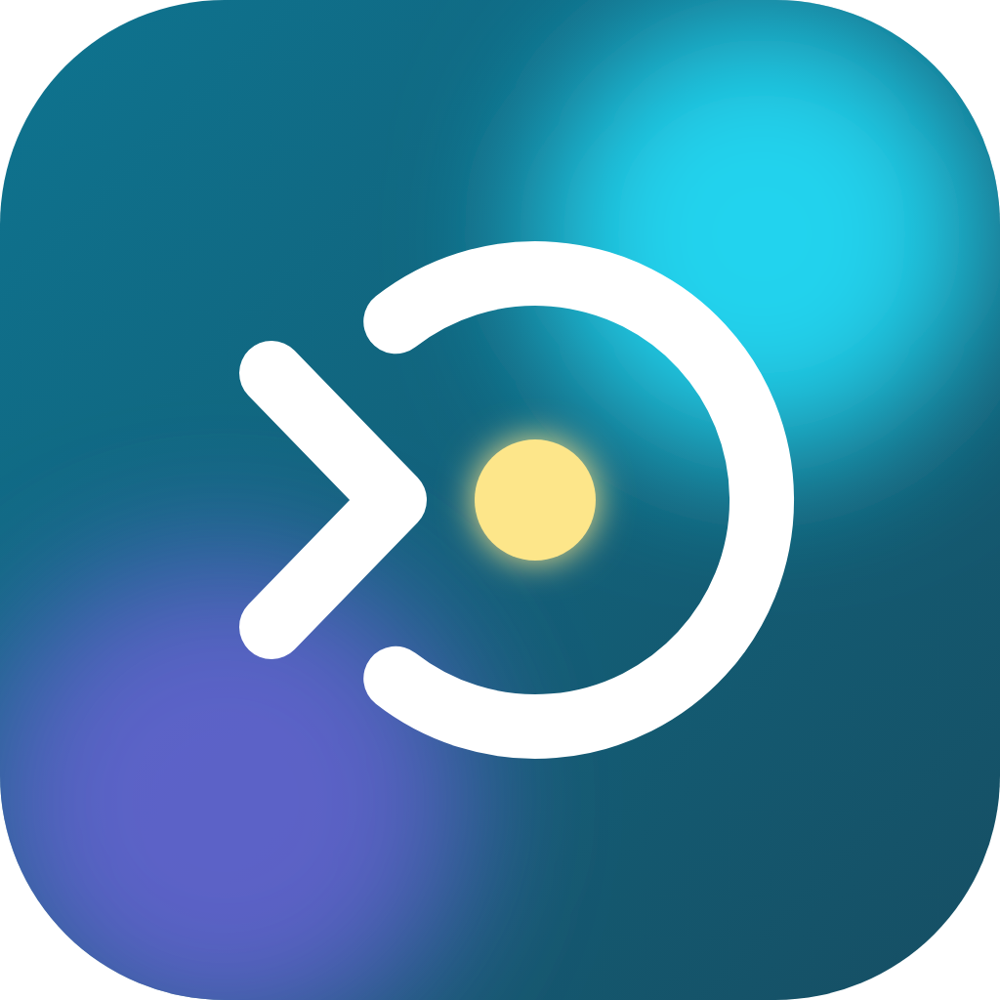

<p align="center"></p>

# Focus Blocks

Time-blocking that rewards showing up. Plan your day in blocks from a template, focus on the block you're in, and keep a streak going.

One Flutter codebase runs on **Mac, iPhone and Android**.

## What's in milestone 1 (core loop, local only)

- **First-run setup**: build a weekday and a weekend template from starter blocks or your own. Gaps between blocks become free time automatically.
- **Now card**: the current block in frosted glass tinted by its color, "Focus until …", a segmented bar (one segment per task plus open time) and "X min left". No running clock.
- **In progress**: the current task with a glass tick and a small time bar that turns orange when you run over.
- **Add tasks**: the **+** in the card opens a panel on the right with task times, position, where it lands, and what to do if it doesn't fit (extend, save for next time, add anyway).
- **Time's up**: "You showed up for …" → **Next Goal!** → Done / Partly / Not really → celebration. **Extend time** (10/15/30/45 min) takes from free time first; later blocks only move by what's left. Nothing runs past midnight.
- **Skip** and **Finish early** live behind the **•••** menu. Skipping asks for a reason and logs it.
- **Today's schedule**: tap a block once for its time and color, again for its tasks (− / + minutes, remove with Undo).
- **Templates**: name them, assign weekdays (one template per day; days without one are free days), edit blocks, mark gaps as free.
- **Progress**: current and longest streak, this week, totals, where the time went, why blocks were skipped.
- **Mac / wide windows**: a sidebar, the Now card and today's schedule side by side.

Everything is saved in a single JSON file on the device. Unfinished tasks carry over to the next run of the same block.

## Platform extras

- **Reminders (all platforms)**: a heads-up 15 minutes before each block and each later task, "15 min left", and "Time's up". Scheduled for today and tomorrow, and rescheduled whenever the plan changes (extend, add a task, edit a template). Turn them off under **Templates → Settings**.
- **Android countdown notification**: while a block runs, a silent ongoing notification shows the block, the task in progress, a live countdown to the end and a progress bar, with **Mark done**, **+15 min** and **Open** buttons.
- **Android home screen widget**: the current block, the task in progress, progress, what's next and your streak. Long-press the home screen → **Widgets** → **Focus Blocks**.
- **Mac menu bar**: a timer icon with "Cisroute · 42m". Its menu shows the task in progress, **Mark done**, **Extend by 15 min**, what's next, **Open** and **Quit**. Closing the window keeps the app running in the menu bar; click the Dock icon to bring it back.

Not yet: iPhone Live Activity / lock screen, sync between devices, Google Calendar.

---

## One-time setup on your Mac

You need macOS 14 or later and about 30 GB free (mostly Xcode and Android tools). Run each command in **Terminal**.

### 1. Xcode (for Mac and iPhone)

1. Install **Xcode** from the App Store and open it once so it finishes installing components.
2. Point the command line tools at it and accept the licence:

   ```sh
   sudo xcode-select --switch /Applications/Xcode.app/Contents/Developer
   sudo xcodebuild -runFirstLaunch
   sudo xcodebuild -license accept
   ```
3. In Xcode, open **Settings → Components** and install the **iOS** platform (for the iPhone simulator).

### 2. Homebrew

```sh
/bin/bash -c "$(curl -fsSL https://raw.githubusercontent.com/Homebrew/install/HEAD/install.sh)"
```

When it finishes, run the two `echo … >> ~/.zprofile` / `eval …` lines it prints so `brew` is on your PATH.

### 3. Flutter and CocoaPods

```sh
brew install --cask flutter
brew install cocoapods
flutter --version
```

You need Flutter **3.38.1 or newer** (`flutter upgrade` if it's older).

### 4. Android Studio (for Android)

```sh
brew install --cask android-studio
```

1. Open Android Studio and go through the setup wizard (it downloads the Android SDK).
2. **Settings → Languages & Frameworks → Android SDK → SDK Tools**: tick **Android SDK Command-line Tools** and apply.
3. Accept the Android licences:

   ```sh
   flutter doctor --android-licenses
   ```

### 5. Check everything

```sh
flutter doctor
```

Fix anything marked ✗ for Xcode, Android toolchain and Flutter. (Chrome and Visual Studio warnings don't matter here.)

---

## Get the code running

```sh
git clone https://github.com/<owner>/<repo>.git focus_blocks
cd focus_blocks

# Generates the ios/, android/ and macos/ folders. Your lib/ and test/ files are left alone.
flutter create . --platforms=ios,android,macos --org com.cisroute --project-name focus_blocks

# Adds the notification, widget and menu bar pieces to those folders.
dart run tool/setup_platforms.dart

flutter pub get

# Puts the app icon (assets/icon/) on Android, iPhone and Mac.
dart run flutter_launcher_icons
flutter test
```

Commit the generated folders afterwards (`git add . && git commit -m "Add platform folders"`), so you only do this once. If you ever regenerate them, run `dart run tool/setup_platforms.dart` again; it's safe to repeat.

The native code lives in `platform/` (Swift for the menu bar, Kotlin and XML for the widget). Edit it there and rerun the script.

### Run on the Mac

```sh
flutter run -d macos
```

### Run on iPhone

**Simulator:**

```sh
open -a Simulator
flutter run
```

**Your own iPhone:**

1. Plug it in, tap **Trust**, and turn on **Settings → Privacy & Security → Developer Mode** (the phone restarts).
2. `open ios/Runner.xcworkspace`, select **Runner → Signing & Capabilities**, tick **Automatically manage signing** and choose your Apple ID as the **Team** (Xcode → Settings → Accounts to add it). A free Apple ID works, but the app expires after 7 days; a paid developer account removes that.
3. Run it:

   ```sh
   flutter devices          # find your iPhone's id
   flutter run --release -d <iphone-id>
   ```
4. The first time, approve the developer on the phone: **Settings → General → VPN & Device Management**.

`--release` keeps the app working after you unplug the phone.

### Run on Android

1. On the phone: **Settings → About phone**, tap **Build number** seven times, then turn on **Developer options → USB debugging**.
2. Plug it in and allow the computer.
3. Run it:

   ```sh
   flutter devices
   flutter run --release -d <android-id>
   ```

No phone handy? Create an emulator in Android Studio (**Device Manager → Create device**) and run `flutter run`.

---

## Day-to-day

| Task | Command |
| --- | --- |
| Run with hot reload | `flutter run -d macos` then press `r` |
| Run the tests | `flutter test` |
| Check for problems | `flutter analyze` |
| Tidy formatting | `dart format lib test` |
| Build the Mac app | `flutter build macos` (app lands in `build/macos/Build/Products/Release/`) |

**Your data** is one JSON file in the app's support folder (on the Mac: `~/Library/Containers/com.cisroute.focusBlocks/Data/Library/Application Support/com.cisroute.focusBlocks/focus_blocks.json`). Delete it to start setup again.

### Allowing reminders

- **iPhone / Mac**: the app asks the first time. If you said no, turn them on in **Settings → Notifications → Focus Blocks** (Mac: **System Settings → Notifications**).
- **Android 13+**: the app asks the first time. For reminders on the exact minute, Android may also need **Settings → Apps → Focus Blocks → Alarms & reminders** turned on; without it they can arrive a few minutes late.

## Project layout

```
lib/
  main.dart            App, setup gate, phone and Mac layouts
  models.dart          Templates, blocks, tasks, day records (JSON)
  schedule_engine.dart Pure scheduling logic: layout, extensions, phases, streaks
  app_state.dart       Riverpod state and every user action
  storage.dart         Local JSON file (swapped for sync in milestone 2)
  stats.dart           Progress numbers
  theme.dart           Colors, glass card, backdrop, segment bar
  quotes.dart          Built-in quotes
  format.dart          Time and date formatting
  live.dart            What reminders, the widget and the menu bar show
  platform/            Notifications, menu bar and widget bridges
  ui/                  Screens, sheets and the add-task panel
platform/              Native code copied in by tool/setup_platforms.dart
tool/                  setup_platforms.dart
test/                  Engine, reminder and widget tests
```

## Troubleshooting

- **`flutter: command not found`**: open a new Terminal window after installing.
- **CocoaPods errors on iOS/macOS**: `cd ios && pod install --repo-update && cd ..` (or `macos` instead of `ios`).
- **"Untrusted developer" on iPhone**: see step 4 of *Your own iPhone*.
- **A screen looks wrong or crashes**: run `flutter analyze`, then send the output.
